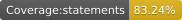
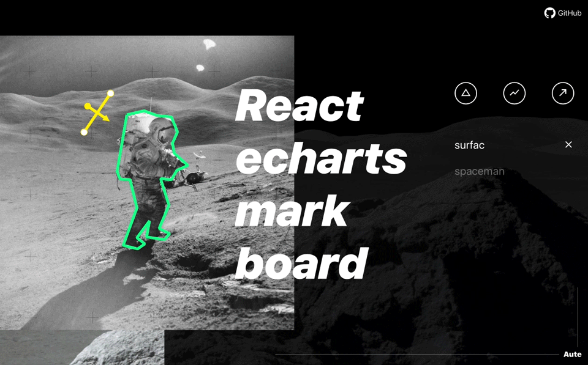

# [react-echarts-mark-board](https://github.com/aute/react-echarts-mark-board) &middot; [](https://github.com/aute/react-echarts-mark-board/blob/master/LICENSE) [](https://www.npmjs.com/package/react-echarts-mark-board)  [](https://aute.github.io/react-echarts-mark-board/coverage/lcov-report/) 

Mark drawing tool, support for drawing lines , rays and other graphics.

English | [简体中文](./README.zh-CN.md)

## 🎁 DEMO
#### 👉 [DEMO](https://aute.github.io/react-echarts-mark-board)


## Directory
```
├── lib - output code
├── docs - Example and docs
├── src - Source code directory
├── CHANGELOG.md - Change log
└── TODO.md - Planned features
```

## Usage Instructions

Using npm, download and install the code. 

```bash
$ npm install --save react-echarts-mark-board
```

For webpack or similar environment：

```js
import MarkBoard from 'react-echarts-mark-board';
```


## Documents
- #### [API](./api.md)
- #### [lib statistics](https://aute.github.io/react-echarts-mark-board/statistics)
- #### [test coverage](https://aute.github.io/react-echarts-mark-board/coverage/lcov-report/)

## Contribution Guide


For the first time to run, you need to install dependencies firstly.

```bash
$ npm install
```

To build the project:

```bash
$ npm run build
```

To run unit tests:

```bash
$ npm test
```


## Change Log
[CHANGELOG.md](./CHANGELOG.md)

## TODO
[TODO.md](./TODO.md)
